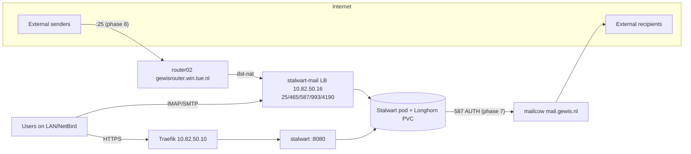

# Stalwart proof of concept

Runbook for deploying [Stalwart](https://stalw.art) v1 as a proof of concept on the
cluster, next to the existing mailcow server (`mail.gewis.nl`).

## Decisions

| What | Value |
| --- | --- |
| Mail domain (addresses) | `stalwart.test.gewis.nl` |
| Server hostname (clients, WebUI, certificate) | `mail.stalwart.test.gewis.nl` |
| Namespace | `stalwart-test` |
| LoadBalancer IP for the mail ports | `10.82.50.16` (`.10`–`.15` are taken; `.15` is `beta.dns.net.gewis.nl` on `dns-lan`) |
| Image | `stalwartlabs/stalwart:v1.0.1` |
| Storage | RocksDB on a Longhorn PVC |
| Outbound mail | relayed through mailcow on `mail.gewis.nl:587` |
| Inbound mail | directly to the cluster via router02 (`gewisrouter.win.tue.nl`) |
| TLS | cert-manager `ClusterIssuer` `letsencrypt-prod` (Cloudflare DNS-01) |

Why it can run next to mailcow without conflicts:

- mailcow has its own public IP (`131.155.69.150`); router02 (`131.155.74.68`) only
  forwards `:443` today, so its mail ports are free.
- `gewis.nl` MX points to `gewis-nl.mail.protection.outlook.com`; nothing about
  `gewis.nl` (MX, SPF, DMARC, autoconfig) is touched.
- Traefik routes by hostname, so `mail.stalwart.test.gewis.nl` coexists with
  `webmail.gewis.nl`.
- `gewis.nl` has `sp=reject` in its DMARC record, so the PoC domain gets its own
  `_dmarc` record.
- Stalwart never gets a Cloudflare token: certificates come from cert-manager and DNS
  records are managed by hand or by external-dns, so it cannot touch the `gewis.nl`
  zone.
- No IP address is written into DNS: the MX points at TU/e's name for router02 and the
  server hostname is a CNAME onto `router02.net.gewis.nl`, like every other app.



Where each piece lives:

| Piece | Repository |
| --- | --- |
| Manifests | `cbc-deployments/stalwart/` |
| Namespace, Flux `GitRepository` + `Kustomization`, RBAC | `k8s-apps/CBC/stalwart/` |
| Address table, router02 forwards (docs), optional Kite access | `infra` |
| DNS records | Cloudflare, by hand (mail records); external-dns (server hostname CNAME) |
| router02 NAT rules | router02, by hand |
| Relay mailbox | mailcow admin UI |

---

## Phase 1: DNS records

The mail domain and the server hostname are separate names because of two DNS rules:
a CNAME cannot coexist with other records on the same name (the mail domain needs MX
and TXT), and an MX target must have an A record, not a CNAME (RFC 2181 §10.3,
RFC 5321 §5.1). `router02.net.gewis.nl` is itself a CNAME onto
`gewisrouter.win.tue.nl`, so the MX points at the latter.

| Name | Type | Value | Managed by |
| --- | --- | --- | --- |
| `stalwart.test.gewis.nl` | MX | `10 gewisrouter.win.tue.nl.` | Cloudflare, by hand |
| `stalwart.test.gewis.nl` | TXT | `v=spf1 include:spfdefault.mail.tue.nl ip4:131.155.69.150 ~all` | Cloudflare, by hand |
| `_dmarc.stalwart.test.gewis.nl` | TXT | `v=DMARC1; p=none; rua=mailto:<you>@gewis.nl` | Cloudflare, by hand |
| `mail.stalwart.test.gewis.nl` | CNAME | `router02.net.gewis.nl` | external-dns, from the IngressRoute annotation |
| DKIM selector(s) under `_domainkey.stalwart.test.gewis.nl` | TXT | from the Zone File view | Cloudflare, by hand, in phase 5 |

- Create the three hand-managed mail records before merging; the CNAME appears once
  the IngressRoute is deployed.
- SPF: mail leaves through mailcow (phase 7). `spfdefault.mail.tue.nl` covers the TU/e
  relays (`131.155.15.52`/`.53`), Outlook and Mailjet; `ip4:131.155.69.150` covers
  mailcow sending directly. Check which path mailcow uses by sending from a mailcow
  mailbox to Gmail and reading the last `Received:` header before Google; drop the
  `ip4:` if it comes from `131.155.15.x`. DMARC passes on Stalwart's DKIM signature
  either way, so SPF is not decisive here.
- Do not copy the SPF of `gewis.nl` or `test.gewis.nl`: SPF is not inherited by
  subdomains, mailcow's IP is not in the `gewis.nl` record, and the `test.gewis.nl`
  record is for Scaleway mail.
- Sending servers connect to `gewisrouter.win.tue.nl` while Stalwart presents a
  certificate for `mail.stalwart.test.gewis.nl`. Opportunistic STARTTLS does not check
  that name; it only rules out MTA-STS and DANE, which the PoC does not use.
- Check with the authoritative nameserver:

  ```sh
  ns=$(dig +short NS gewis.nl | head -1)
  dig +short @$ns MX stalwart.test.gewis.nl
  dig +short @$ns TXT stalwart.test.gewis.nl
  dig +short @$ns TXT _dmarc.stalwart.test.gewis.nl
  ```

## Phase 2: manifests in `cbc-deployments/stalwart/`

### `kustomization.yaml`

```yaml
apiVersion: kustomize.config.k8s.io/v1beta1
kind: Kustomization

resources:
  - certificate.yaml
  - statefulset.yaml
  - service.yaml
  - ingress.yaml
  - secrets.yaml

configMapGenerator:
  - name: stalwart-config
    files:
      - config.json
```

### `config.json`

Only the data store lives here; every other setting is stored in the database and
edited through the WebUI or `stalwart-cli`.

```json
{"@type": "RocksDb", "path": "/var/lib/stalwart"}
```

### `certificate.yaml`

Traefik's default wildcard covers `*.test.gewis.nl`, not the extra level in
`mail.stalwart.test.gewis.nl`, and that secret lives in the `traefik` namespace anyway.
This certificate serves both the IngressRoute and Stalwart's IMAPS and SMTPS listeners.

```yaml
apiVersion: cert-manager.io/v1
kind: Certificate
metadata:
  name: stalwart-tls
spec:
  secretName: stalwart-tls
  issuerRef:
    name: letsencrypt-prod
    kind: ClusterIssuer
  dnsNames:
    - mail.stalwart.test.gewis.nl
```

### `statefulset.yaml`

A StatefulSet gives the pod a stable hostname, from which Stalwart derives its node id.
The `logs` emptyDir exists because without the setup wizard Stalwart's default `Log`
tracer writes to `/var/log/stalwart`, which the image does not create and UID 2000
cannot write. RocksDB sizes its block cache from the memory limit.

```yaml
apiVersion: apps/v1
kind: StatefulSet
metadata:
  name: stalwart
spec:
  serviceName: stalwart-headless
  replicas: 1
  selector:
    matchLabels:
      io.kompose.service: stalwart
  template:
    metadata:
      labels:
        io.kompose.service: stalwart
    spec:
      securityContext:
        runAsUser: 2000
        runAsGroup: 2000
        fsGroup: 2000
      containers:
        - name: stalwart
          image: stalwartlabs/stalwart:v1.0.1
          imagePullPolicy: IfNotPresent
          args: ["--config", "/etc/stalwart/config.json"]
          env:
            - name: TZ
              value: Europe/Amsterdam
          envFrom:
            - secretRef:
                name: stalwart-secrets
          ports:
            - { name: smtp, containerPort: 25 }
            - { name: submissions, containerPort: 465 }
            - { name: submission, containerPort: 587 }
            - { name: imaps, containerPort: 993 }
            - { name: sieve, containerPort: 4190 }
            - { name: http, containerPort: 8080 }
          livenessProbe:
            httpGet: { path: /healthz/live, port: http }
            initialDelaySeconds: 30
            periodSeconds: 10
          readinessProbe:
            httpGet: { path: /healthz/ready, port: http }
            initialDelaySeconds: 5
            periodSeconds: 10
          resources:
            requests: { cpu: 100m, memory: 512Mi }
            limits: { memory: 2Gi }
          volumeMounts:
            - { name: config, mountPath: /etc/stalwart/config.json, subPath: config.json, readOnly: true }
            - { name: tls, mountPath: /etc/stalwart/tls, readOnly: true }
            - { name: data, mountPath: /var/lib/stalwart }
            - { name: logs, mountPath: /var/log/stalwart }
      volumes:
        - name: config
          configMap:
            name: stalwart-config
        - name: tls
          secret:
            secretName: stalwart-tls
        - name: logs
          emptyDir: {}
  volumeClaimTemplates:
    - metadata:
        name: data
      spec:
        accessModes: [ReadWriteOnce]
        storageClassName: longhorn
        resources:
          requests:
            storage: 10Gi
```

### `service.yaml`

`externalTrafficPolicy: Local` keeps the real client IP (needed for SPF checks, spam
filtering and auto-ban), so no PROXY protocol is needed.

```yaml
apiVersion: v1
kind: Service
metadata:
  name: stalwart-headless
spec:
  clusterIP: None
  selector:
    io.kompose.service: stalwart
  ports:
    - { name: http, port: 8080 }
---
apiVersion: v1
kind: Service
metadata:
  name: stalwart
spec:
  selector:
    io.kompose.service: stalwart
  ports:
    - { name: http, port: 8080, targetPort: 8080 }
---
apiVersion: v1
kind: Service
metadata:
  name: stalwart-mail
  annotations:
    lbipam.cilium.io/ips: 10.82.50.16
spec:
  type: LoadBalancer
  externalTrafficPolicy: Local
  selector:
    io.kompose.service: stalwart
  ports:
    - { name: smtp, port: 25, targetPort: 25 }
    - { name: submissions, port: 465, targetPort: 465 }
    - { name: submission, port: 587, targetPort: 587 }
    - { name: imaps, port: 993, targetPort: 993 }
    - { name: sieve, port: 4190, targetPort: 4190 }
```

### `ingress.yaml`

The whole host is limited to the LAN, NetBird and TU/e while it is a PoC. The
external-dns annotation makes external-dns create the CNAME
`mail.stalwart.test.gewis.nl` → `router02.net.gewis.nl`, like the other apps.

```yaml
apiVersion: traefik.io/v1alpha1
kind: Middleware
metadata:
  name: stalwart-internal-only
spec:
  ipAllowList:
    sourceRange:
      - 10.0.0.0/8
      - 100.64.0.0/10
      - 131.155.0.0/16
---
apiVersion: traefik.io/v1alpha1
kind: IngressRoute
metadata:
  name: stalwart
  annotations:
    external-dns.alpha.kubernetes.io/target: router02.net.gewis.nl
spec:
  entryPoints:
    - websecure
  routes:
    - match: Host(`mail.stalwart.test.gewis.nl`)
      kind: Rule
      middlewares:
        - name: stalwart-internal-only
      services:
        - name: stalwart
          port: 8080
  tls:
    secretName: stalwart-tls
```

### `secrets.template.yaml`

```yaml
apiVersion: v1
kind: Secret
metadata:
  name: stalwart-secrets
  namespace: stalwart-test
type: Opaque
stringData:
  STALWART_RECOVERY_ADMIN: admin:REPLACE_ME
  SMARTHOST_PASSWORD: REPLACE_ME
```

- `STALWART_RECOVERY_ADMIN` is a full-permission credential that is accepted in every
  mode, not just recovery mode. Use a long random password and remove it at the end of
  phase 5.
- `SMARTHOST_PASSWORD` is the mailcow relay mailbox password from phase 7; use a
  placeholder until then.

### `secrets.yaml`

`secrets.test.yaml` is gitignored by the `secrets.*.yaml` rule. The controller name
and namespace come from `infra/flux/10_sealed-secrets`.

```sh
cp stalwart/secrets.template.yaml stalwart/secrets.test.yaml   # fill in both values
kubeseal --controller-name sealed-secrets-controller --controller-namespace sealed-secrets \
  --scope namespace-wide --format yaml < stalwart/secrets.test.yaml > stalwart/secrets.yaml
```

Add the `sealedsecrets.bitnami.com/namespace-wide: "true"` annotation to the
`metadata` and `spec.template.metadata` of the result if kubeseal did not, matching the
other `secrets.yaml` files in this repo.

### Check

```sh
kubectl kustomize stalwart/
```

## Phase 3: Flux wiring in `k8s-apps/CBC/stalwart/`

Mirrors the `CBC/nextcloud` test environment. The existing `app-deployer` Role already
allows StatefulSets, Services, cert-manager Certificates, SealedSecrets, IngressRoutes
and Middlewares.

### `kustomization.yaml`

```yaml
apiVersion: kustomize.config.k8s.io/v1beta1
kind: Kustomization

resources:
  - source.yaml
  - test.yaml
  - rbac-test
```

### `source.yaml`

```yaml
apiVersion: source.toolkit.fluxcd.io/v1
kind: GitRepository
metadata:
  name: stalwart
  namespace: flux-system
spec:
  interval: 1m
  url: https://github.com/GEWIS/cbc-deployments.git
  ref:
    branch: main
```

### `test.yaml`

```yaml
apiVersion: kustomize.toolkit.fluxcd.io/v1
kind: Kustomization
metadata:
  name: stalwart-test
  namespace: flux-system
spec:
  interval: 1m
  path: "./stalwart"
  prune: true
  sourceRef:
    kind: GitRepository
    name: stalwart
  serviceAccountName: app-deployer
  targetNamespace: stalwart-test
---
apiVersion: v1
kind: Namespace
metadata:
  name: stalwart-test
```

### `rbac-test/kustomization.yaml`

```yaml
apiVersion: kustomize.config.k8s.io/v1beta1
kind: Kustomization

components:
  - ../../../components/app-rbac

transformers:
  - ns.yaml
```

### `rbac-test/ns.yaml`

```yaml
apiVersion: builtin
kind: NamespaceTransformer
metadata:
  name: ns
  namespace: stalwart-test
fieldSpecs:
  - path: metadata/namespace
    create: true
```

### `CBC/kustomization.yaml`

Add `- stalwart` to `resources`, between `slugshrink` and `webhost`.

## Phase 4: `infra`

1. Confirm the IP is free. Assigned addresses are not only those pinned in git: a
   LoadBalancer Service without `lbipam.cilium.io/ips` gets any free address from the
   pool, so list what Cilium actually handed out:

   ```sh
   kubectl get svc -A -o jsonpath='{range .items[?(@.spec.type=="LoadBalancer")]}{.metadata.namespace}/{.metadata.name}{"\t"}{.status.loadBalancer.ingress[*].ip}{"\n"}{end}'
   ```

   `10.82.50.16` must not appear.
2. Add `| 10.82.50.16 | Stalwart PoC mail ports, stalwart-mail |` to the address table
   in `docs/talos/ingress.md`. That table also lacks `10.82.50.15`
   (`beta.dns.net.gewis.nl`, the second `dns-lan` address since commit `83c3be3`), and
   `docs/cluster/resolver.md` still describes `dns-lan` as only `10.82.50.11`; fix both
   in the same change.
3. Optional: give a group Kite access by adding an entry to
   `flux/50_apps/kite/app-access.yaml`:

   ```yaml
   - name: stalwart
     group: "<CBC group>"
     namespaces: [stalwart-test]
   ```

## Phase 5: deploy and bootstrap

1. Merge `cbc-deployments` first, then `k8s-apps`.
2. Reconcile and wait:

   ```sh
   flux reconcile kustomization external-apps --with-source
   flux get kustomizations stalwart-test
   kubectl -n stalwart-test get certificate,pod,svc
   ```

   Expected: Certificate `READY=True`, pod `stalwart-0` `1/1 Running`, Service
   `stalwart-mail` with `EXTERNAL-IP 10.82.50.16`, and the CNAME published:

   ```sh
   dig +short CNAME mail.stalwart.test.gewis.nl   # router02.net.gewis.nl.
   ```
3. Because `config.json` exists, Stalwart never enters bootstrap mode: there is no
   setup wizard and no temporary password. Sign in with the recovery admin:

   ```sh
   kubectl -n stalwart-test port-forward svc/stalwart 8080:8080
   ```

   Open `http://127.0.0.1:8080/admin` and sign in as `admin` with the password from
   the secret.
4. Configure in the WebUI:

   | # | What | Where / object | Values |
   | --- | --- | --- | --- |
   | 1 | TLS certificate | Settings › TLS › Certificates (`Certificate`) | `certificate`: `{"@type":"File","filePath":"/etc/stalwart/tls/tls.crt"}`, `privateKey`: `{"@type":"File","filePath":"/etc/stalwart/tls/tls.key"}` |
   | 2 | Domain | Management › Domains › Domains (`Domain`) | `stalwart.test.gewis.nl`; `certificateManagement: Manual`, `dnsManagement: Manual`, `dkimManagement: Automatic` |
   | 3 | Defaults | `SystemSettings` | `defaultHostname: mail.stalwart.test.gewis.nl`, `defaultDomainId`: the domain, `defaultCertificateId`: the certificate |
   | 4 | Console logging | Settings › Telemetry › Tracers (`Tracer`) | add `{"@type":"Stdout","level":"info","ansi":false}`; keep the `Log` tracer, the WebUI log viewer needs it |
   | 5 | Submission on 587 | Settings › Network › Listeners (`NetworkListener`) | add `{"name":"submission","protocol":"smtp","bind":{"[::]:587":true}}`; the defaults are 25, 465, 993, 995, 4190, 443 and 8080 only |
   | 6 | Accounts | Management › Directory › Accounts | a permanent administrator account, plus test users `jane` and `john`; passwords under Authentication › Credentials › Add item (min. 8 characters) |
   | 7 | DKIM | domain menu › View Zone File | publish the DKIM TXT record(s) in Cloudflare; with manual DNS the keys are never rotated, which is fine for a PoC |

5. Listener changes need a restart:

   ```sh
   kubectl -n stalwart-test rollout restart statefulset/stalwart
   ```

6. Move to the public URL once the permanent administrator account works:
   1. Add to the container `env` in `statefulset.yaml` and merge:

      ```yaml
      - name: STALWART_PUBLIC_URL
        value: https://mail.stalwart.test.gewis.nl
      ```

   2. Settings › Network › HTTP: `clientIpSource: xForwardedFor`, `forwardedHops: 1`.
   3. Restart again. From now on use `https://mail.stalwart.test.gewis.nl/admin`.
7. Remove `STALWART_RECOVERY_ADMIN` from `secrets.test.yaml`, re-seal, merge.

## Phase 6: internal tests

No router or firewall changes needed. Run from a machine on the LAN or on NetBird.

1. `mail.stalwart.test.gewis.nl` resolves to router02, which does not forward mail
   ports yet, so override it locally in `/etc/hosts`:

   ```
   10.82.50.16 mail.stalwart.test.gewis.nl
   ```

2. TLS, submission and local delivery:

   ```sh
   openssl s_client -connect mail.stalwart.test.gewis.nl:993 -servername mail.stalwart.test.gewis.nl </dev/null \
     | grep -E 'subject|issuer|Verify'

   swaks --server mail.stalwart.test.gewis.nl:465 --tls-on-connect \
     --auth-user jane@stalwart.test.gewis.nl --auth-password '…' \
     --from jane@stalwart.test.gewis.nl --to john@stalwart.test.gewis.nl

   swaks --server mail.stalwart.test.gewis.nl:25 \
     --from test@example.org --to john@stalwart.test.gewis.nl

   kubectl -n stalwart-test logs statefulset/stalwart -f
   ```

3. Thunderbird: IMAP `mail.stalwart.test.gewis.nl:993` SSL/TLS, SMTP `:465` SSL/TLS,
   the full address (`jane@stalwart.test.gewis.nl`) as user name.
4. Account Manager: `https://mail.stalwart.test.gewis.nl/account`.

## Phase 7: outbound through mailcow

1. In mailcow, create the mailbox `stalwart-relay@gewis.nl` with a strong password.
   Edit it and enable **Allow to send as \***; without it mailcow rejects
   `@stalwart.test.gewis.nl` senders, because that domain is not a mailcow domain. This
   makes the mailbox an open relay credential, so treat its password accordingly.
2. Put the password in `SMARTHOST_PASSWORD`, re-seal, merge.
3. Settings › MTA › Outbound › Routes, add:

   ```json
   {"@type":"Relay","name":"smarthost","host":"mail.gewis.nl","port":587,"protocol":"smtp","implicitTls":false,
    "authUsername":"stalwart-relay@gewis.nl","authSecret":{"@type":"EnvironmentVariable","variableName":"SMARTHOST_PASSWORD"}}
   ```

4. Settings › MTA › Outbound › Strategy, set `route` to:

   ```json
   {"match":{"0":{"if":"is_local_domain(rcpt_domain)","then":"'local'"}},"else":"'smarthost'"}
   ```

5. Send from `jane@stalwart.test.gewis.nl` to a Gmail address. "Show original" should
   show `dkim=pass header.d=stalwart.test.gewis.nl` and `dmarc=pass`. Replies bounce
   until phase 8.

## Phase 8: inbound from the internet

1. From outside the TU/e network (e.g. a phone hotspot), check whether router02
   accepts port 25 at all:

   ```sh
   nc -vz gewisrouter.win.tue.nl 25
   ```

2. On router02, forward the mail ports to the LoadBalancer IP, keeping the source
   address (like the existing `:443` forward):

   ```
   /ip firewall nat add chain=dstnat dst-address=131.155.74.68 protocol=tcp dst-port=25,465,587,993 \
     action=dst-nat to-addresses=10.82.50.16 comment="stalwart-poc"
   ```

3. Ask TU/e ICTS to allow inbound TCP 25 to `131.155.74.68` if it is filtered at the
   border (`gewis.nl` itself receives through Microsoft, so this is likely).
4. Remove the `/etc/hosts` override, send from Gmail to
   `jane@stalwart.test.gewis.nl`, and reply.
5. Document the mail forwards in the router02 section of `infra/docs/talos/ingress.md`.

## Phase 9 (optional): real mailboxes

Copy a few mailboxes from mailcow; imapsync does not modify the source without
`--delete1`:

```sh
imapsync --host1 mail.gewis.nl --ssl1 --user1 someone@gewis.nl --password1 '…' \
         --host2 mail.stalwart.test.gewis.nl --ssl2 --user2 jane@stalwart.test.gewis.nl --password2 '…'
```

## Phase 10: teardown

1. Remove `- stalwart` from `k8s-apps/CBC/kustomization.yaml` and delete
   `k8s-apps/CBC/stalwart/`. Flux prunes the Kustomization and the namespace; the PVC
   goes with the namespace.
2. Delete `cbc-deployments/stalwart/`.
3. Delete the MX, SPF, `_dmarc` and DKIM records from phase 1. Also delete the CNAME
   `mail.stalwart.test.gewis.nl` and its `edns-` ownership TXT record: external-dns
   runs with `policy: upsert-only` and never deletes records.
4. Delete the `stalwart-poc` NAT rule on router02 and its entry in the infra docs.
5. Delete the `stalwart-relay@gewis.nl` mailbox in mailcow.
6. Remove the `10.82.50.16` row from `infra/docs/talos/ingress.md`.

## Known limits

- cert-manager renews the certificate after about 60 days, but Stalwart only reads
  certificate files at startup or on `ReloadTlsCertificates`, and deletes an expired
  file-backed `Certificate` object at load time. Run
  `kubectl -n stalwart-test rollout restart statefulset/stalwart` after a renewal.
- All configuration beyond `config.json` lives in the database, not in git. Beyond the
  PoC, keep it as an NDJSON plan applied with `stalwart-cli apply`
  ([declarative deployments](https://stalw.art/docs/configuration/declarative-deployments/)),
  and move to PostgreSQL (OpenBao `ExternalSecret`, like mattermost) and S3 (SeaweedFS)
  storage; changing the data store later requires a data migration.
- The JSON in phases 5 and 7 has not been applied to a live server. The field names
  and WebUI paths come from the v1 docs.

## References

- Kubernetes: <https://stalw.art/docs/cluster/orchestration/kubernetes/>
- Kubernetes chart reference: <https://stalw.art/docs/cluster/orchestration/kubernetes-chart/>
- Default listeners: <https://stalw.art/docs/server/listener#default-listeners>
- Certificates: <https://stalw.art/docs/server/tls/certificates>
- Reverse proxy: <https://stalw.art/docs/server/reverse-proxy/>
- Relay routing: <https://stalw.art/docs/mta/outbound/routing#relay-delivery>
- Recovery mode: <https://stalw.art/docs/configuration/recovery-mode>
- mailcow sender rules: <https://docs.mailcow.email/models/model-sender_rcv/>
